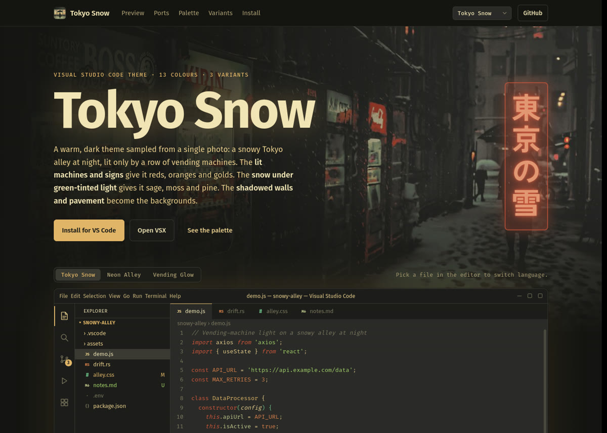

<p align="center">
  <a href="https://tokyo-snow.matthewgadsden.dev">
    
  </a>
</p>
<h1 align="center">
  Tokyo Snow Website
</h1>

<div align="center">
  
  
  
  
</div>

<div align="center">
  
  
  
</div>

<p align="center">
  The website for <a href="https://github.com/MatthewGadsden/tokyo-snow-vs">Tokyo Snow</a>, a warm, dark colour theme sampled from a snowy Tokyo alley at night, lit by vending machines.
  <br/>
  <a href="https://tokyo-snow.matthewgadsden.dev"><b>tokyo-snow.matthewgadsden.dev</b></a>
</p>

<p align="center">
  <a href="https://tokyo-snow.matthewgadsden.dev">
    
  </a>
</p>

It's a static site: plain HTML, CSS and JavaScript, with no build step and no dependencies.

## What's on it

- **Home page** (`index.html`): the hero, a live VS Code preview with four sample files, the ports grid with search and filters, the 13-colour palette, the three variants, and install steps.
- **Port pages** (`ports/*.html`): one page per port (VS Code, VSCodium, Neovim, Hyprland, Hyprlock, Waybar, Rofi, Bash and Oh My Posh). Each has a live mock of the app in the palette, install steps, a table of where each colour goes, and links to the config files.
- **Variant switcher**: Tokyo Snow, Neon Alley and Vending Glow recolour the whole site. The choice is saved in the browser and carried to other pages as `?v=<variant>` on the site's own links, so it survives even where storage is per page.

## Running it locally

Open `index.html` in a browser. Everything works from disk, including the port pages.

To serve it over HTTP instead:

```bash
python3 -m http.server 8000
```

Then open <http://localhost:8000>.

## Deploying

The site runs at [tokyo-snow.matthewgadsden.dev](https://tokyo-snow.matthewgadsden.dev) as a Cloudflare Worker that serves only static assets, with no Worker script. The GitHub Actions workflow in `.github/workflows/deploy.yml` deploys it when a `v*` tag is pushed, or by hand from the Actions tab:

```bash
git tag v1.0.0
git push origin v1.0.0
```

The workflow syntax-checks the scripts, and checks that every port in `data.js` has a page in `ports/`. It then copies the site into `dist/`, leaving out dotfiles, `README.md`, `LICENSE` and `wrangler.jsonc`, and runs `wrangler deploy`.

`wrangler.jsonc` holds the Worker's name (`tokyo-snow`), the assets folder and the custom domain.

One-time setup, in the GitHub repository's **Settings → Secrets and variables → Actions**:

- `CLOUDFLARE_ACCOUNT_ID`: your Cloudflare account ID.
- `CLOUDFLARE_API_TOKEN`: an API token made from the **Edit Cloudflare Workers** template. It needs the Workers routes permission on the `matthewgadsden.dev` zone so the deploy can attach the custom domain.

The first deploy creates the Worker and attaches `tokyo-snow.matthewgadsden.dev`, as long as the `matthewgadsden.dev` zone is in the same Cloudflare account.

Two files only do anything once deployed:

- `404.html` is served, with a 404 status, for any path that doesn't exist (`not_found_handling` in `wrangler.jsonc`). It uses root-relative URLs (`/style.css`) so it works at any depth, which means it only renders properly when served, not opened from disk.
- `_headers` sets security headers on every response and a one-week cache on `assets/`.

Cloudflare also drops `.html` from URLs, so `/ports/neovim.html` redirects to `/ports/neovim`. The canonical and Open Graph URLs use those short forms. If the domain changes, update `https://tokyo-snow.matthewgadsden.dev` in `index.html` and `ports/*.html`.

## Project layout

| Path | What it is |
| --- | --- |
| `index.html` | Home page |
| `ports/*.html` | Port pages. Each one only sets `data-port="<slug>"` and loads the shared scripts. |
| `data.js` | All site content: the palette (`TS.VARIANTS`), colour roles, and every port's page content (`TS.PORTS`) |
| `site.js` | Shared by every page: nav and footer, variant switching, copy buttons, port cards |
| `editor.js` | The VS Code window mock and its syntax highlighter, used on the home page and both editor port pages |
| `main.js` | Home page: ports grid, palette, variants, snowfall |
| `port.js` | Renders a port page and its mock from `TS.PORTS` |
| `style.css` | Site styles and the palette tokens |
| `port.css` | Port page and mock styles |
| `assets/` | Banner, icon, wallpaper and the Rofi side-panel image |
| `404.html` | Not-found page, served by the Worker for missing paths |
| `_headers` | Response headers for the Worker's static assets |
| `wrangler.jsonc` | Cloudflare Worker config: name, assets folder, custom domain |
| `.github/workflows/deploy.yml` | Checks and deploys the site on `v*` tags |

The scripts are plain scripts sharing a `window.TS` namespace rather than ES modules, so the site still works when opened from disk. Load order matters: `data.js`, `site.js`, `editor.js`, then the page script.

## Common changes

### Add a port

1. Add an entry to `TS.PORTS` in `data.js`. Copy an existing entry and change its `slug`, text, install steps, colour mapping and details.
2. Copy any file in `ports/` to `ports/<slug>.html`. Change its `<title>`, description, `data-port`, and the slug and text in the canonical link and `og:` tags.
3. Pick a preview for the entry. `"editor"` reuses the VS Code mock. For a new kind of mock, add a function to `MOCKS` in `port.js` and its styles to `port.css`.

The port then shows up in the home page grid, the footer and every page's "More ports" list.

### Change a colour

The palette lives in `TS.VARIANTS` in `data.js` and must match the theme in [tokyo-snow-vs](https://github.com/MatthewGadsden/tokyo-snow-vs). The values on `:root` in `style.css` are only the defaults shown before the script runs, so keep them in step with the Tokyo Snow variant.

## Credits

The theme, banner and icon come from [tokyo-snow-vs](https://github.com/MatthewGadsden/tokyo-snow-vs). The wallpaper, Rofi panel image and desktop config values come from [gaddo-arch](https://github.com/MatthewGadsden/gaddo-arch), and the Bash and Oh My Posh configs from [mgadsden-configs](https://github.com/MatthewGadsden/mgadsden-configs).

Fonts are loaded from Google Fonts: Fira Sans, Fira Code, Zen Kaku Gothic New (for the 東京の雪 sign) and Inter (on the Hyprlock page).

## License

[MIT](LICENSE)
